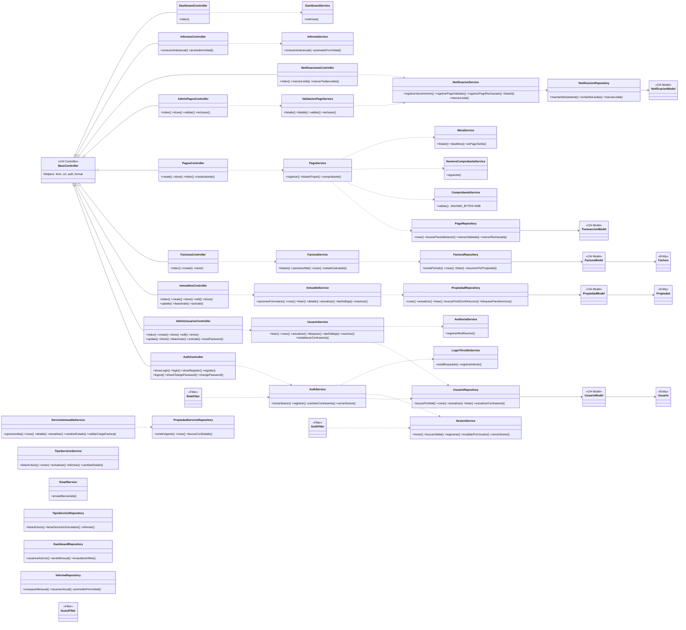
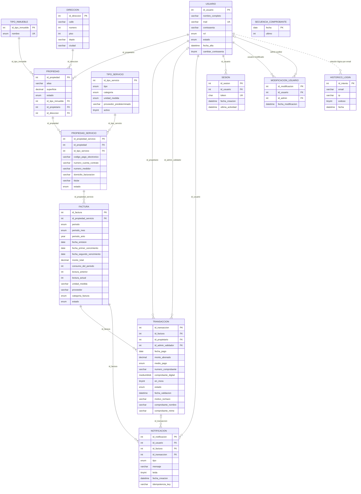
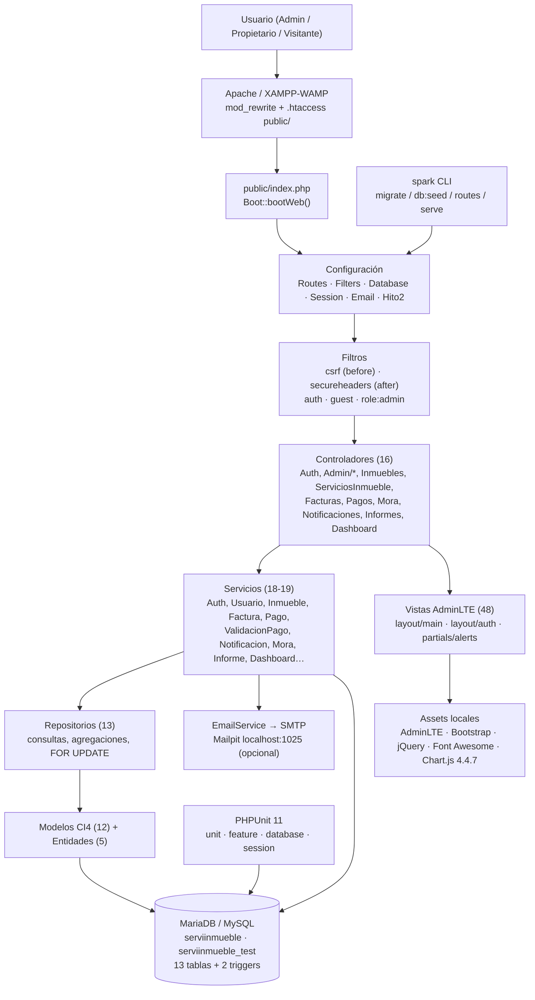
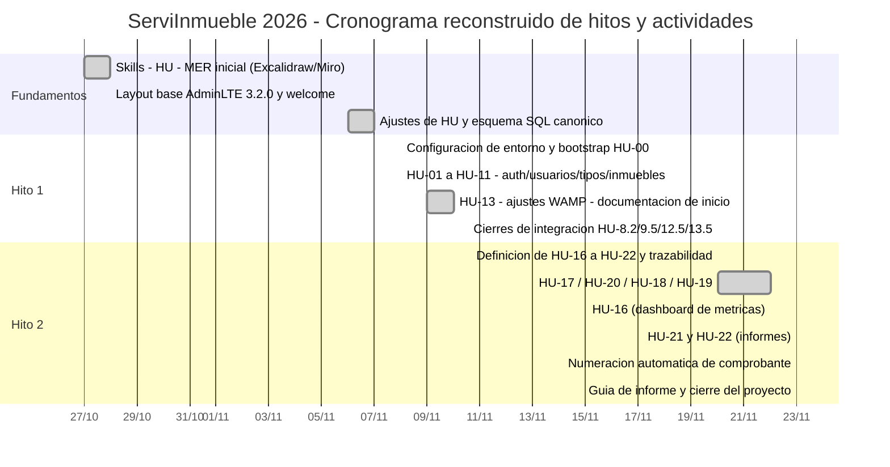

# Informe Final de Proyecto de Software

## ServiInmueble 2026 — Sistema web de gestión de inmuebles, servicios, facturación y pagos

| Dato | Valor |
|---|---|
| Proyecto | ServiInmueble 2026 |
| Repositorio | `/mnt/c/xampp/htdocs/servi-inmueble` |
| Framework | CodeIgniter 4.7.5 (PHP ≥ 8.2) |
| Base de datos | MySQL / MariaDB (`serviinmueble`, `serviinmueble_test`) |
| Interfaz | AdminLTE 3.2.0 + Bootstrap + jQuery + Chart.js 4.4.7 (local) |
| Metodología | Desarrollo por hitos/sprints, historias de usuario en Gherkin y trazabilidad CA → código/test |
| Hitos | Hito 1 (HU-00 a HU-15) y Hito 2 (HU-16 a HU-22) |
| Período de desarrollo | 27/10/2026 → 23/11/2026 (47 commits, 5 merges de PR) |
| Fecha del informe | 23/11/2026 |
| Fuentes principales | `guia-de-desarrollo-informe-final.txt`, `documentacion_proyecto.txt`, `docs/`, `app/`, `bd/`, `tests/`, `agents/` |

> **Nota de alcance documental.** El presente informe se elaboró exclusivamente a partir del código y la documentación presentes en el repositorio. Donde la documentación y el código difieren, se aclara explícitamente. En particular: (a) `docs/rutas.md` describe 48 rutas del Hito 1 mientras que `app/Config/Routes.php` define 62 rutas actuales; (b) `docs/historias_de_usuario/hito2/HU_Hito2_compacto.md` (20/11/2026) indica «Sin implementación» para el Hito 2, pero los commits del 22 y 23/11/2026 incorporan HU-16, HU-21 y HU-22 y sus tests; (c) el último resultado de suite completa documentado es **140 tests / 855 assertions; OK** (tras HU-20), sin un registro posterior de suite completa luego de las últimas incorporaciones. No se ejecutaron pruebas durante la redacción de este informe.

---

## 1. Introducción

### 1.1. Introducción General

ServiInmueble 2026 es una aplicación web desarrollada en **CodeIgniter 4** que permite a propietarios y administradores gestionar de forma centralizada el ciclo completo de sus inmuebles: alta de inmuebles y de servicios asociados, emisión de facturas, registro y validación de pagos, control de mora, notificaciones internas, panel de métricas e informes de consumo.

El proyecto se construyó en **dos hitos**:

- **Hito 1 (HU-00 a HU-15):** bootstrap técnico, autenticación, administración de usuarios, catálogo de tipos de servicio, inmuebles, vinculación de servicios a inmuebles y facturación con totales.
- **Hito 2 (HU-16 a HU-22):** dashboard de métricas, registro de pagos con comprobante digital, validación administrativa de pagos, mora, notificaciones internas, informe de consumo interanual y promedio de consumo por unidad de medida.

La aplicación es de **servidor** (server-side first): toda la autorización, el alcance por rol y las reglas de negocio se validan en backend, incluso si la interfaz oculta acciones no permitidas. La persistencia es **MySQL/MariaDB** con un esquema canónico definido en `bd/serviinmueble (1).sql`, reproducido mediante migraciones, y la presentación se apoya en **AdminLTE 3** con assets vendorizados localmente (sin CDN).

### 1.2. Definición del Problema

A partir del análisis de requerimientos documentado (`documentacion_proyecto.txt`, `docs/historias_de_usuario/`), se identificó la necesidad de centralizar la gestión de propiedades y su facturación en una única plataforma web con las siguientes problemáticas de base:

1. **Ausencia de un sistema unificado:** los datos de propietarios, inmuebles, servicios (agua, gas, electricidad, internet, etc.), facturas y pagos se gestionan de manera dispersa, sin un modelo de datos común que preserve el historial.
2. **Falta de control de acceso por rol:** un mismo sistema debe servir a un Administrador con visión global y a un Propietario que solo debe ver y operar sobre sus propios inmuebles, servicios, facturas y pagos.
3. **Pérdida de trazabilidad:** al modificar un tipo de servicio o dar de baja un usuario/inmueble, debe conservarse el historial de facturas y pagos; la eliminación física no es aceptable salvo casos muy acotados.
4. **Estados ambiguos:** la condición «vencida» de una factura no es un dato almacenable, sino un estado calculado a partir de los vencimientos; su persistencia generaría inconsistencias.
5. **Proceso de pagos sin validación:** registrado un pago, se requiere que el Administrador lo valide o rechace antes de que la factura cambie de estado, con notificación al propietario y comprobante digital seguro.
6. **Falta de visibilidad:** se requieren métricas e informes (consumo interanual, promedios por unidad) para monitorear facturación, recaudación, mora y notificaciones.

### 1.3. Breve Descripción de la Solución

Se implementó una aplicación web MVC por capas sobre CodeIgniter 4, con:

- **Autenticación robusta:** registro, login/logout, cambio de contraseña, hash Argon2id (fallback bcrypt), sesión persistida en tabla `sesion` con expiración de 30 minutos, bloqueo por fuerza bruta (5 fallos en 15 minutos) y contraseñas temporales de uso obligatorio.
- **Alcance por rol:** `admin` (global) y `propietario` (limitado a `propiedad.id_propietario = session('id_usuario')`), con 403 real y vista amigable ante accesos denegados.
- **ABM con bajas lógicas:** usuarios, tipos de servicio, inmuebles y vínculos servicio-inmueble; las facturas y transacciones nunca se eliminan.
- **Facturación con snapshot:** cada factura guarda «foto» de proveedor, categoría y unidad de medida; estado `pendiente`/`pagada` en BD y `vencida` calculado con `COALESCE(fecha_segundo_vencimiento, fecha_primer_vencimiento)`.
- **Pagos y validación:** pago por el total, comprobante PDF/JPG/JPEG ≤ 5 MB validado por contenido (`finfo`), numeración automática `CP-YYYYMMDD-NNNNNN`, validación/rechazo administrativo con notificación idempotente.
- **Mora, notificaciones e informes:** reporte de facturas vencidas sin intereses, cuatro tipos de notificación interna (`por_vencer`, `vencida`, `pago_validado`, `pago_rechazado`), dashboard con gráficos de 12 meses y distribución de estados, e informes con Chart.js local.

### 1.4. Metodología de Desarrollo

La metodología surge de `documentacion_proyecto.txt` y de los prompts generales (`docs/prompts/PROMPT_GENERAL_hito1.md`, `prompt-general-hito-2.md`):

1. **Planificación por hitos/sprints.** Sprint 1 = análisis, diseño e implementación del Hito 1; Sprint 2 = análisis, diseño e implementación del Hito 2, repitiendo el proceso con un análisis adicional de consistencia de HU previo a la implementación.
2. **Modelado conceptual.** MER diseñado en **Excalidraw** (la documentación indica que la URL se encuentra en el repositorio; la URL no aparece en los archivos actuales) y mapa de historias de usuario en **Miro**.
3. **Especificación en Gherkin.** **OpenCode – Big Pickle** analizó requerimientos y generó las historias de usuario y criterios de aceptación en formato Gherkin; el mismo formato se respetó para todas las HU y documentación posterior.
4. **Revisión y detección de huecos.** La IA integrada de Miro detectó vacíos en las tablas de HU; se generó documentación de los mismos y se solicitó a **Claude Code** su corrección.
5. **Ingeniería de prompts y SKILLs.** Con OpenCode se definieron un SKILL mayor de tecnologías/arquitectura y SKILLs específicas de construcción, seguridad/auditoría y front-end (10 archivos `agents/*/SKILL.md`). Se crearon traza de ejecución y prompt general que verifica el uso de skills: «una sesión por historia de usuario y pusimos arnés a la IA».
6. **Base de datos.** Diseño en **phpMyAdmin**, debatiendo tipos y objetos; luego se comparó el modelo físico con las HU para detectar fallas y corregirlas. Regla de oro resultante: si un skill, prompt o código contradice al SQL canónico o a `docs/decisiones.md`, **manda el SQL canónico** (D-01).
7. **Implementación asistida.** OpenCode revisó las HU y generó prompts que fueron ejecutados en **VS Code**. Orden de implementación por dependencias: Hito 1 `00→01→02→03→04→06→05→07→09→08→10→12→11→13→14→15`; Hito 2 `17→20→18→19→16→21→22` (HU-21 y HU-22 en paralelo).
8. **Revisión continua.** «En todas las etapas tuvimos instancias de revisión»: validadores de HU, auditoría de seguridad, tests y reportes de verificación en `docs/reportes/`.
9. **Dinámica de reuniones.** Diarias de **2 a 3 horas**, con registro de tiempo por HU (ver §5.1).

**Fuentes de verdad jerárquicas (Hito 1):** SQL canónico → `docs/decisiones.md` → `docs/rutas.md` → HU compacta → notas H-24…H-33 → bootstrap → SKILLs. El Hito 2 agrega `docs/historias_de_usuario/hito2/README.md`, `HU_Hito2_compacto.md` y `trazabilidad-hito-2.md` (decisiones D2-01…D2-13, decisiones de implementación DI-01…DI-09).

### 1.5. Definición del Entorno de Ejecución (Herramientas utilizadas)

| Herramienta / tecnología | Versión declarada / observada | Uso |
|---|---|---|
| PHP | objetivo 8.3; `composer.json` exige `^8.2`; se documentó CLI 8.2.12 y guía WAMP 8.3.28 | Lenguaje de ejecución |
| CodeIgniter | 4.7.5 (`CI_VERSION`) | Framework MVC |
| MariaDB / MySQL | objetivo 10.11.16; también registrado 10.4.32 | Persistencia (MySQLi) |
| Apache | XAMPP con `mod_rewrite` / WampServer | Servidor web; alternativa `spark serve` |
| Composer | 2.11.1 | Gestión de dependencias |
| AdminLTE | 3.2.0 (assets en `public/assets/adminlte/`) | Plantilla de interfaz |
| Bootstrap / jQuery / Font Awesome / Chart.js | vendorizados; Chart.js 4.4.7 local | UI y gráficos |
| PHPUnit | 11.5.57 (`composer.lock`) | Pruebas unitarias, feature y base de datos |
| PhpMyAdmin | incluido en XAMPP | Diseño y carga del esquema |
| Mailpit | SMTP `localhost:1025`, UI `http://localhost:8025` | Captura de correos en desarrollo (opcional) |
| OpenCode (Big Pickle), Claude Code, VS Code | IA y editor | Análisis, generación de HU, prompts, SKILLs e implementación |
| Excalidraw, Miro | Herramientas de diseño | MER conceptual y mapa de HU |
| Gantter.com | Sugerido por la guía | Elaboración del diagrama de Gantt |

Extensiones PHP requeridas por `composer.json`: `intl`, `mbstring`; verificadas por `scripts/check_env.php`: `mysqli`, `openssl`, `json`, `curl` además de las anteriores.

---

## 2. Identificación de Necesidades

### 2.1. Objetivos del Sistema

**Objetivo general.** Proveer una plataforma web segura y trazable para la administración integral de inmuebles, servicios asociados, facturación, pagos y seguimiento de mora, con visibilidad diferenciada para Administradores y Propietarios.

**Objetivos específicos:**

1. Registrar y autenticar usuarios con contraseñas hasheadas, sesiones invalidables y protección contra fuerza bruta.
2. Gestionar usuarios y catálogos (tipos de inmueble y de servicio) con altas, ediciones, bajas lógicas y auditoría.
3. Administrar inmuebles con dirección separada, estados y propiedad verificada en servidor.
4. Vincular servicios a inmuebles con datos contractuales (CPE, cuenta, medidor, domicilio de facturación, titular) y transiciones de estado controladas.
5. Emitir facturas mensuales/anuales con snapshot histórico, vencimientos y cálculo de estado «vencida».
6. Registrar pagos con comprobante seguro y numeración automática, y someterlos a validación administrativa.
7. Informar mora, generar notificaciones internas idempotentes y ofrecer métricas e informes de consumo.
8. Garantizar integridad referencial, conservación del historial y autorización por rol en todas las operaciones.

### 2.2. Alcance del Sistema

**Hito 1 — implementado (HU-00 a HU-15):**

| Bloque | Funcionalidad |
|---|---|
| HU-00 | Bootstrap técnico: configuración, migraciones y seeds reproducibles, filtros, 48 rutas explícitas, capas Service/Repository/Entity, correo y tests MySQL |
| HU-01 – HU-03 | Registro de usuarios, inicio/cierre de sesión, sesión persistida y cambio de contraseña |
| HU-04 – HU-06 | Alta, modificación/baja y consulta de usuarios (Administrador) |
| HU-07 – HU-09 | Alta, modificación/baja y consulta de tipos de servicio; catálogo para Propietario |
| HU-10 – HU-12 | Alta, modificación/baja y consulta de inmuebles; listado global de Admin |
| HU-13 | Vinculación de servicios a inmueble y transiciones de estado |
| HU-14 – HU-15 | Alta de factura y listado con totales de pendiente/pagado/general |

**Hito 2 — definido e implementado (HU-16 a HU-22):**

| Bloque | Funcionalidad |
|---|---|
| Administración general | HU-16: dashboard de métricas globales / por propietario con gráficos |
| Facturación y pagos | HU-17 registro de pago con comprobante; HU-18 validación/rechazo admin; HU-19 control de mora; HU-20 notificaciones internas |
| Informes y métricas | HU-21 consumo interanual; HU-22 promedio de consumo por unidad |

**Fuera de alcance del Hito 2:** pagos parciales o saldo a favor; intereses, recargos o punitorios por mora; pasarela de pagos o débito automático real; envío de emails o notificaciones push (las notificaciones son internas); generación de PDF de facturas/comprobantes; edición o eliminación de pagos ya registrados; recuperación de contraseña autoservicio; API/SPA; perfil propio; reportes administrativos distintos de los informes de consumo.

**Estado actual del código:** el árbol contiene controladores, servicios, repositorios, vistas y tests para HU-16, HU-21 y HU-22, incorporados en commits del 22 y 23/11/2026 (`aeea491`, `2363c54`, `076df34`, `15527cb`, `6af32bb`). La documentación de estado (20/11/2026) aún los marca como pendientes; se recomienda actualizar esos documentos en el cierre del proyecto.

### 2.3. Tipología de Usuarios

| Rol / etiqueta UI | Valor en BD | Descripción |
|---|---|---|
| **Administrador** | `admin` | Acceso global a usuarios, inmuebles, servicios, facturas, pagos, mora, métricas y notificaciones (lectura global). Valida o rechaza pagos. |
| **Propietario** | `propietario` | Acceso únicamente a sus inmuebles y a los servicios, facturas, pagos, mora, notificaciones e informes derivados. Registra pagos y marca sus notificaciones como leídas. |
| **Visitante** | sin sesión | Solo páginas públicas: inicio, `/auth/login` y `/auth/registro`. Se registra con rol `propietario` y estado `activo`. |

**Estados de usuario:** `activo`, `bloqueado` (bloqueo administrativo), `baja` (baja lógica). El bloqueo transitorio por fuerza bruta **no** modifica `usuario.estado`.

### 2.4. Organización y Funciones de los usuarios

La organización es jerárquica por rol y, dentro del rol Propietario, por propiedad: un Administrador supervisa a todos los usuarios y sus operaciones; un Propietario es dueño de una o más `propiedad`, y cada `propiedad` puede tener varios `propiedad_servicio`, cada uno con sus `factura` y `transaccion`.

| Función | Visitante | Propietario | Administrador | Mecanismo de control |
|---|---|---|---|---|
| Registro e inicio de sesión | Sí | Redirige a dashboard | Redirige a dashboard | Filtro `guest` |
| Cierre de sesión / cambio de contraseña | No | Sí | Sí | Filtro `auth` |
| Dashboard y catálogo de servicios | No | Sí (solo activos) | Sí | Filtro `auth` + filtro en repositorio |
| Alta/edición/baja de inmuebles | No | Solo propios | Todos | Servicio: `id_propietario = session('id_usuario')` o rol `admin` |
| Servicios del inmueble y facturas | No | Solo de sus inmuebles | Todos | Servicio + repositorio con filtro de propiedad |
| Pago de facturas | No | Solo sus facturas | Todas | `PagoService` verifica propiedad/rol |
| Validar o rechazar pagos | No | No (403) | Sí | Filtro `role:admin` + `ValidacionPagoService` |
| Administrar usuarios y tipos de servicio | No | No (403) | Sí | Grupo `/admin` con `auth` + `role:admin` |
| Mora e informes | No | Solo sus datos | Global | Repositorios filtran por `id_propietario` |
| Notificaciones | No | Las suyas; marcar leídas | Todas en lectura | `NotificacionService` (admin no marca leídas) |
| Ver notificaciones sin leer (campanita) | No | Sí | No | `layout/header.php` condicionado a rol |

Acceso denegado: **HTTP 403** con `app/Views/errors/html/error_403.php`, mensaje «No tiene permisos para esta acción» y botón «Volver al dashboard». No se usan redirecciones silenciosas.

---

## 3. Análisis de Requisitos

### 3.1. Identificación y Detalle de las Historias de Usuario

Las 22 historias de usuario (más el bootstrap HU-00) se documentaron en Gherkin en `docs/historias_de_usuario/hito1/` y `docs/historias_de_usuario/hito2/`, con criterios de aceptación numerados (CA-xx.y, BC-01…BC-20). A continuación se presenta la matriz trazable.

| ID | Título | Actor | Hito | Criterios | Funcionalidad clave / estado |
|---|---|---|---|---|---|
| HU-00 | Bootstrap técnico | Proyecto | 1 | BC-01…BC-20 | Configuración, 11 tablas + 2 triggers, seeds idempotentes, 48 rutas, filtros, correo, PHPUnit MySQL. Implementado |
| HU-01 | Registro de nuevos usuarios | Visitante | 1 | CA-01.1…01.6 | Registro con hash, email único *case-insensitive*, rol Propietario, cuenta activa, términos, email de bienvenida. Implementada |
| HU-02 | Inicio de sesión | Usuario registrado | 1 | CA-02.1…02.4 | Login, regeneración de sesión, expiración 30 min, throttle, contraseña temporal. Implementada |
| HU-03 | Cierre de sesión | Usuario autenticado | 1 | CA-03.1 | Destrucción de sesión y cookie; ruta protegida vuelve al login. Implementada |
| HU-04 | Alta de usuarios | Administrador | 1 | CA-04.1…04.6 | Alta con rol/estado, duplicados, solo Admin. Implementada |
| HU-05 | Modificación y baja de usuarios | Administrador | 1 | CA-05.1…05.8 | Edición, bloqueo, baja lógica, reactivación, reseteo, autoprotección, auditoría, invalidación de sesiones. Implementada |
| HU-06 | Consulta y listado de usuarios | Administrador | 1 | CA-06.1…06.5 | Columnas, búsqueda parcial, filtros por rol/estado, detalle, estado vacío. Implementada |
| HU-07 | Alta de tipos de servicio | Administrador | 1 | CA-07.1…07.6 | `tipo` ENUM, categoría, unidad compatible, proveedor, unicidad `(tipo, proveedor)`. Implementada |
| HU-08 | Modificación y baja de tipos de servicio | Administrador | 1 | CA-08.1…08.6 | Edición sin alterar snapshots, desactivar, borrado físico solo sin uso, reactivación. Implementada |
| HU-09 | Consulta y listado de tipos de servicio | Admin y Propietario | 1 | CA-09.1…09.5 | Listado Admin con acciones; catálogo Propietario solo activos; detalle con cantidad de inmuebles. Implementada |
| HU-10 | Alta de inmuebles | Propietario / Admin | 1 | CA-10.1…10.6 | Dirección separada, catálogo de tipos, superficie decimal, asignación de propietario. Implementada |
| HU-11 | Modificación y baja de inmuebles | Propietario / Admin | 1 | CA-11.1…11.6 | Edición, baja lógica (`inactivo`), sin nuevas cargas, reactivación, control de propiedad. Implementada |
| HU-12 | Consulta y listado de inmuebles | Propietario / Admin | 1 | CA-12.1…12.5 | Grilla filtrable, detalle con servicios y resumen de facturación, vista Admin global. Implementada |
| HU-13 | Vinculación de servicios a un inmueble | Propietario | 1 | CA-13.1…13.9 | CPE/cuenta/medidor, vínculo vigente único, transiciones `activo→pausado→en revision→activo`, baja lógica. Implementada |
| HU-14 | Alta de factura | Propietario / Admin | 1 | CA-14.1…14.6 | Período mes/año, snapshot, vencimientos, lecturas/consumo, estado calculado, duplicados. Implementada |
| HU-15 | Listado de facturas con totales | Propietario / Admin | 1 | CA-15.1…15.5 | Pendiente/pagado/general, filtros, vencidas suman al pendiente. Implementada |
| HU-16 | Dashboard de métricas globales | Admin / Propietario | 2 | CA-16.1…16.8 | Tarjetas, serie 12 meses, distribución de estados, enlaces filtrados, «Sin datos». Código y test presentes |
| HU-17 | Registro de pago con comprobante | Propietario / Admin | 2 | CA-17.1…17.10 | Pago por el total, comprobante validado, `en_mora`, numeración `CP-…`, pago pendiente. Implementada |
| HU-18 | Validación de pagos | Administrador | 2 | CA-18.1…18.10 | Lista de pendientes, validar/rechazar con motivo, factura pagada solo al validar, notificación. Implementada |
| HU-19 | Control de mora | Admin / Propietario | 2 | CA-19.1…19.8 | Días `hoy - vencimiento`, filtros, marca histórica `en_mora`, sin intereses. Implementada |
| HU-20 | Notificaciones internas | Propietario / Admin | 2 | CA-20.1…20.11 | Cuatro tipos, ventana 7 días configurable, idempotencia, campanita, marcar leídas. Implementada |
| HU-21 | Informe de consumo interanual | Admin / Propietario | 2 | CA-21.1…21.9 | Comparativa de dos años, 12 puntos por año, meses sin factura en 0, resumen anual aparte. Código y test presentes |
| HU-22 | Promedio de consumo por unidad | Admin / Propietario | 2 | CA-22.1…22.8 | Promedio por kWh/m³/Gigas (consumo) y Moneda fija (monto), filtros, gráfico/tabla. Código y test presentes |

**Ejemplo de escenario Gherkin** (redacción sintetizada de HU-17 a partir de sus CA, conservando los mensajes literales del sistema):

```gherkin
Usuario: Propietario o Administrador
Característica: Registro de pago con comprobante digital

  Escenario: Pago con comprobante queda pendiente de validación
    Dado que el usuario es el propietario de la factura o un administrador
    Y la factura está pendiente o vencida (estado calculado)
    Cuando registra un pago por el monto total con comprobante PDF/JPG/JPEG de hasta 5 MB
    Entonces se crea una transacción en estado "pendiente"
    Y la factura continúa en su estado original
    Y se genera el número de comprobante "CP-AAAAMMDD-NNNNNN"
    Y se muestra "Pago registrado. Queda pendiente de validación."

  Escenario: El monto no coincide con el total
    Cuando registra un pago con un monto distinto al total de la factura
    Entonces se rechaza con "El monto debe ser igual al total de la factura"
```

**Orden de ejecución acordado** (por dependencias, no numérico):

- Hito 1: `00 → 01 → 02 → 03 → 04 → 06 → 05 → 07 → 09 → 08 → 10 → 12 → 11 → 13 → 14 → 15`.
- Hito 2: `17 → 20 → 18 → 19 → 16 → 21 → 22` (HU-21 y HU-22 pueden ejecutarse en paralelo; HU-18 depende del `NotificacionService` de HU-20).

### 3.2. Diagrama de Clases

La aplicación combina entidades de dominio, modelos CodeIgniter, repositorios, servicios y controladores. Las cinco entidades (`Usuario`, `Propiedad`, `TipoServicio`, `PropiedadServicio`, `Factura`) son marcadores que extienden `CodeIgniter\Entity\Entity`; los modelos devuelven arrays (`$returnType = 'array'`) y definen `$allowedFields` como whitelist de escritura, con `$useTimestamps = false`.



**Reglas de negocio relevantes por capa de servicio:**

- `AuthService`: mail normalizado (`mb_strtolower(trim())`), política de contraseña ≥ 8 caracteres con letra y número, rechazo de reutilización, 5 fallos en 900 s por email o IP.
- `UsuarioService`: duplicado de mail incluye usuarios en `baja`; un admin no puede bloquearse, darse de baja ni quitarse el rol; bloqueo/baja invalidan sesiones y escriben auditoría en la misma transacción.
- `InmuebleService`: superficie > 0 con hasta 2 decimales y 8 enteros; alta de dirección + propiedad transaccional; baja → `inactivo`; reactivación → `disponible`.
- `ServicioInmuebleService`: transiciones `activo→pausado`, `pausado→en revision`, `en revision→activo`, y cualquiera → `inactivo`; impide vínculos vigentes duplicados y facturas sobre servicios pausados.
- `TipoServicioService`: matriz tipo/unidad idéntica al trigger; no elimina tipos con inmuebles vinculados («No se puede eliminar: tiene inmuebles asociados»).
- `FacturaService`: `periodo_anio` 1901–2155; emisión no futura; segundo vencimiento > primero; con medidor calcula consumo como `lectura_actual - lectura_anterior`; `vencida` nunca se persiste.
- `PagoService`: monto exacto con `number_format(..., 2, '.', '')`; comprobante obligatorio salvo efectivo; rechazo de segundo pago pendiente; número `CP-\d{8}-\d{6}` con `INSERT IGNORE` + `SELECT … FOR UPDATE` sobre `secuencia_comprobante` (tope 999999 diario).
- `ValidacionPagoService`: transaccional con `FOR UPDATE`; `validar()` marca factura `pagada`; `rechazar()` exige motivo de 1–255 caracteres y deja la factura pendiente.
- `NotificacionService`: claves idempotentes `venc:{id_factura}:{tipo}` y `pago:{id_transaccion}:{tipo}`; ventana `diasPorVencer = 7` desde `app/Config/Hito2.php`; Admin lee pero no marca leídas.

### 3.3. Modelo de Datos

#### 3.3.1. Diagrama Entidad–Relación



**Cardinalidades y decisiones de integridad:**

- `USUARIO 1:N PROPIEDAD`, `TIPO_INMUEBLE 1:N PROPIEDAD`, `DIRECCION 1:N PROPIEDAD`.
- `PROPIEDAD N:M TIPO_SERVICIO`, resuelta mediante la tabla pivote con atributos `PROPIEDAD_SERVICIO` (PK surrogate `id_propiedad_servicio`). La unicidad de vínculo vigente **no** está en la BD: se implementa en `PropiedadServicioRepository::existeVigente()` para estados `activo`, `pausado` y `en revision`.
- `PROPIEDAD_SERVICIO 1:N FACTURA`, con UNIQUE por `(id_propiedad_servicio, periodo, periodo_anio, periodo_mes)`.
- `FACTURA 1:N TRANSACCION`; desde el Hito 2, `UNIQUE(id_factura, numero_comprobante)`.
- `USUARIO 1:N TRANSACCION` como pagador y `0..1:N` como validador; `FACTURA 1:N NOTIFICACION`, `USUARIO 1:N NOTIFICACION` con UNIQUE `(id_usuario, idempotencia_key)`, `TRANSACCION 0..1:N NOTIFICACION`.
- **Ninguna FK usa `ON DELETE CASCADE`**: todas son `RESTRICT / RESTRICT`. Las bajas son lógicas (`usuario.estado='baja'`, `propiedad.estado='inactivo'`, `propiedad_servicio.estado='inactivo'`, `tipo_servicio.activo=0`). Única excepción: borrado físico de `tipo_servicio` sin vínculos (HU-08).
- `historico_login` se relaciona lógicamente con `usuario.mail` por `email`, sin FK. `secuencia_comprobante` es independiente (PK `fecha`).

#### 3.3.2. Modelo relacional (definición de tablas, columnas, FK, etc.)

Fuente: `bd/serviinmueble (1).sql`, migraciones `app/Database/Migrations/` y `bd/carga_datos_serviinmueble.sql`. Las 11 tablas del Hito 1 usan `ENGINE=InnoDB`, `utf8mb4` / `utf8mb4_unicode_ci`.

**1. `tipo_inmueble`** — catálogo sembrado (5 valores).

| Columna | Tipo | NULL | Default | Restricción |
|---|---|---|---|---|
| `id_tipo_inmueble` | INT AI | NO | — | PK |
| `nombre` | ENUM('casa','departamento','local comercial','oficina','galpon') | NO | — | UNIQUE `index_nombre_tipo_inmueble` |

**2. `tipo_servicio`** — catálogo maestro de servicios.

| Columna | Tipo | NULL | Default | Restricción |
|---|---|---|---|---|
| `id_tipo_servicio` | INT AI | NO | — | PK |
| `tipo` | ENUM('agua','gas','electricidad','internet','telefonia','television','impuesto','expensas','otro') | NO | — | — |
| `categoria` | ENUM('publico','privado') | NO | — | — |
| `unidad_medida` | ENUM('kWh','m³','Gigas','Moneda fija') | NO | — | UNIQUE compuesta; validada por trigger |
| `proveedor_predeterminado` | VARCHAR(45) | NO | — | UNIQUE compuesta |
| `activo` | TINYINT(1) | NO | 1 | 0 = bloqueado/dado de baja |

UNIQUE `index_tipo_proveedor (tipo, proveedor_predeterminado)`. Triggers `trg_tipo_servicio_unidad_bi` (BEFORE INSERT) y `trg_tipo_servicio_unidad_bu` (BEFORE UPDATE): si la unidad no es compatible con el tipo, `SIGNAL SQLSTATE '45000'` con mensaje «Unidad de medida no compatible con el tipo de servicio». Matriz: electricidad → kWh/Moneda fija; agua y gas → m³/Moneda fija; internet, telefonía y televisión → Gigas/Moneda fija; impuesto y expensas → Moneda fija; otro → las cuatro.

**3. `direccion`**

| Columna | Tipo | NULL | Default | Restricción |
|---|---|---|---|---|
| `id_direccion` | INT AI | NO | — | PK |
| `calle` | VARCHAR(45) | NO | — | KEY `index_calle_nro (calle, numero)` |
| `numero` | INT | NO | — | índice compuesto |
| `piso` | INT | SÍ | NULL | — |
| `depto` | VARCHAR(10) | SÍ | NULL | — |
| `ciudad` | VARCHAR(60) | NO | — | — |

**4. `usuario`**

| Columna | Tipo | NULL | Default | Restricción |
|---|---|---|---|---|
| `id_usuario` | INT AI | NO | — | PK |
| `nombre_completo` | VARCHAR(50) | NO | — | — |
| `mail` | VARCHAR(100) | NO | — | UNIQUE `index_mail`, case-insensitive |
| `contrasenia` | VARCHAR(255) | NO | — | Hash Argon2id/bcrypt |
| `rol` | ENUM('propietario','admin') | NO | 'propietario' | D-02: sin tabla `roles` |
| `estado` | ENUM('activo','bloqueado','baja') | NO | 'activo' | — |
| `fecha_alta` | DATETIME | NO | CURRENT_TIMESTAMP | — |
| `cambiar_contrasenia` | TINYINT(1) | NO | 0 | 1 = debe cambiar contraseña |

**5. `modificacion_usuario`** — auditoría de acciones de admin.

| Columna | Tipo | NULL | Default | Restricción |
|---|---|---|---|---|
| `id_modificacion` | INT AI | NO | — | PK |
| `id_usuario` | INT | NO | — | FK → `usuario(id_usuario)` RESTRICT; KEY `(id_usuario, fecha_modificacion)` |
| `id_admin` | INT | NO | — | FK → `usuario(id_usuario)` RESTRICT; KEY `(id_admin)` |
| `fecha_modificacion` | DATETIME | NO | CURRENT_TIMESTAMP | — |

**6. `sesion`**

| Columna | Tipo | NULL | Default | Restricción |
|---|---|---|---|---|
| `id_sesion` | INT AI | NO | — | PK |
| `id_usuario` | INT | NO | — | FK → `usuario(id_usuario)` RESTRICT |
| `token` | CHAR(64) | NO | — | UNIQUE `index_token_sesion` |
| `fecha_creacion` | DATETIME | NO | CURRENT_TIMESTAMP | — |
| `ultima_actividad` | DATETIME | SÍ | NULL | Expiración a los 1800 s |

**7. `propiedad`**

| Columna | Tipo | NULL | Default | Restricción |
|---|---|---|---|---|
| `id_propiedad` | INT AI | NO | — | PK |
| `alias` | VARCHAR(45) | NO | — | UNIQUE `(id_propietario, alias)` |
| `superficie` | DECIMAL(10,2) | NO | — | > 0, máx. 2 decimales |
| `estado` | ENUM('ocupado','disponible','en mantenimiento','inactivo') | NO | — | `inactivo` = baja lógica |
| `id_tipo_inmueble` | INT | NO | — | FK → `tipo_inmueble` RESTRICT |
| `id_propietario` | INT | NO | — | FK → `usuario` RESTRICT (`fk_duenio_inmueble`) |
| `id_direccion` | INT | NO | — | FK → `direccion` RESTRICT |

**8. `propiedad_servicio`** — tabla pivote N:M con atributos.

| Columna | Tipo | NULL | Default | Restricción |
|---|---|---|---|---|
| `id_propiedad_servicio` | INT AI | NO | — | PK |
| `id_propiedad` | INT | NO | — | FK → `propiedad` RESTRICT |
| `id_tipo_servicio` | INT | NO | — | FK → `tipo_servicio` RESTRICT |
| `codigo_pago_electronico` | VARCHAR(20) | NO | — | CPE/Pagar |
| `numero_cuenta_contrato` | VARCHAR(20) | NO | — | — |
| `numero_medidor` | VARCHAR(20) | SÍ | NULL | Opcional |
| `domicilio_facturacion` | VARCHAR(45) | NO | — | — |
| `titular` | VARCHAR(50) | NO | — | — |
| `estado` | ENUM('activo','pausado','en revision','inactivo') | SÍ | 'activo' | Baja lógica; NULL permitido por esquema |

Sin UNIQUE en BD sobre `(id_propiedad, id_tipo_servicio)`: la unicidad de vínculo vigente se resuelve en aplicación (CA-13.4).

**9. `factura`**

| Columna | Tipo | NULL | Default | Restricción |
|---|---|---|---|---|
| `id_factura` | INT AI | NO | — | PK |
| `id_propiedad_servicio` | INT | NO | — | FK → `propiedad_servicio` RESTRICT |
| `periodo` | ENUM('mes','anio') | NO | 'mes' | UNIQUE compuesta |
| `periodo_mes` | ENUM('00','01'…'12') | NO | '00' | UNIQUE compuesta |
| `periodo_anio` | YEAR | NO | — | UNIQUE compuesta (1901–2155) |
| `fecha_emision` | DATE | NO | — | No futura |
| `fecha_primer_vencimiento` | DATE | NO | — | — |
| `fecha_segundo_vencimiento` | DATE | SÍ | NULL | Si existe, es el vencimiento aplicable |
| `monto_total` | DECIMAL(12,2) | NO | — | > 0 |
| `consumo_del_periodo` | INT | NO | — | Entero no negativo |
| `lectura_anterior` | INT | SÍ | NULL | — |
| `lectura_actual` | INT | SÍ | NULL | ≥ lectura anterior |
| `unidad_medida` | VARCHAR(15) | NO | — | Snapshot histórico |
| `proveedor` | VARCHAR(45) | NO | — | Snapshot histórico |
| `categoria_factura` | ENUM('publico','privado') | NO | — | Snapshot histórico |
| `estado` | ENUM('pendiente','pagada') | NO | 'pendiente' | «vencida» NUNCA se persiste |

UNIQUE `index_factura_periodo (id_propiedad_servicio, periodo, periodo_anio, periodo_mes)`. CHECK `chk_factura_periodo`: `(periodo='mes' AND periodo_mes<>'00') OR (periodo='anio' AND periodo_mes='00')`. Índices del Hito 2: `idx_factura_estado_vencimientos (estado, fecha_primer_vencimiento, fecha_segundo_vencimiento)` e `idx_factura_periodo_servicio (periodo_anio, periodo_mes, id_propiedad_servicio)`.

**10. `transaccion`** — pagos (columnas originales + extensiones Hito 2).

| Columna | Tipo | NULL | Default | Restricción |
|---|---|---|---|---|
| `id_transaccion` | INT AI | NO | — | PK |
| `id_factura` | INT | NO | — | FK → `factura` RESTRICT |
| `id_propietario` | INT | NO | — | FK → `usuario` RESTRICT |
| `fecha_pago` | DATE | NO | — | No futura |
| `monto_abonado` | DECIMAL(12,2) | NO | — | Debe igualar `factura.monto_total` |
| `medio_pago` | ENUM('transferencia','debito automatico','efectivo','billetera virtual') | NO | — | — |
| `numero_comprobante` | VARCHAR(50) | NO | — | UNIQUE `(id_factura, numero_comprobante)`; formato `CP-AAAAMMDD-NNNNNN` |
| `comprobante_digital` | MEDIUMBLOB | SÍ | NULL | PDF/JPEG, ≤ 5 MiB |
| `en_mora` | TINYINT(1) | NO | 0 | Marca histórica inmutable |
| `estado` | ENUM('pendiente','validada','rechazada') | NO | 'pendiente' | Hito 2 |
| `id_admin_validador` | INT | SÍ | NULL | FK → `usuario` RESTRICT |
| `fecha_validacion` | DATETIME | SÍ | NULL | — |
| `motivo_rechazo` | VARCHAR(255) | SÍ | NULL | 1–255 caracteres al rechazar |
| `comprobante_nombre` | VARCHAR(255) | SÍ | NULL | — |
| `comprobante_mime` | VARCHAR(100) | SÍ | NULL | — |

KEY `idx_transaccion_estado_pago (estado, fecha_pago)`. Backfill en la migración del Hito 2: pagos históricos → `validada` con `fecha_validacion = CONCAT(fecha_pago, ' 00:00:00')`.

**11. `historico_login`**

| Columna | Tipo | NULL | Default | Restricción |
|---|---|---|---|---|
| `id_intento` | INT AI | NO | — | PK |
| `email` | VARCHAR(100) | NO | — | KEY `(email, fecha)`, `(email, ip, fecha)` |
| `ip` | VARCHAR(45) | NO | — | KEY `(ip, fecha)`; IPv4/IPv6 |
| `exitoso` | TINYINT(1) | NO | 0 | 0 fallido / 1 exitoso |
| `fecha` | DATETIME | NO | CURRENT_TIMESTAMP | — |

**12. `notificacion`** (Hito 2)

| Columna | Tipo | NULL | Default | Restricción |
|---|---|---|---|---|
| `id_notificacion` | INT AI | NO | — | PK |
| `id_usuario` | INT | NO | — | FK → `usuario` RESTRICT |
| `id_factura` | INT | NO | — | FK → `factura` RESTRICT |
| `id_transaccion` | INT | SÍ | NULL | FK → `transaccion` RESTRICT |
| `tipo` | ENUM('por_vencer','vencida','pago_validado','pago_rechazado') | NO | — | — |
| `mensaje` | VARCHAR(255) | NO | — | — |
| `leida` | TINYINT(1) | NO | 0 | — |
| `fecha_creacion` | DATETIME | NO | CURRENT_TIMESTAMP | DEFAULT aplicado por ALTER en la migración |
| `idempotencia_key` | VARCHAR(120) | NO | — | UNIQUE `(id_usuario, idempotencia_key)` |

KEY `idx_notificacion_usuario_leida (id_usuario, leida, fecha_creacion)` y claves por `(id_usuario, id_factura, tipo)` y `(id_usuario, id_transaccion, tipo)`.

**13. `secuencia_comprobante`** (23/11/2026)

| Columna | Tipo | NULL | Default | Restricción |
|---|---|---|---|---|
| `fecha` | DATE | NO | — | PK |
| `ultimo` | INT UNSIGNED | NO | 0 | Correlativo diario; tope 999999 en el servicio |

**Datos semilla (`app/Database/Seeds/`):** `DatabaseSeeder` ejecuta `TipoInmuebleSeeder` (5 tipos), `TipoServicioSeeder` (9 servicios: agua/Aguas Rionegrinas, gas/Camuzzi, electricidad/Edenor, internet, telefonía, televisión, impuesto/Municipalidad, expensas/Administración del edificio, otro), `AdminUserSeeder` (`admin@serviinmueble.local` / `Admin1234`, `cambiar_contrasenia=1`) y `DemoSeeder` solo si `ENVIRONMENT !== 'production'` (propietario demo, un inmueble, un servicio, tres facturas y una transacción validada). `bd/carga_datos_serviinmueble.sql` agrega datos de demostración y marca aplicadas las 12 migraciones del Hito 1.

---

## 4. Estudio de la Arquitectura

### 4.1. Arquitectura Escogida

Se adoptó una **arquitectura web en capas sobre CodeIgniter 4**, con separación explícita entre presentación, control HTTP, lógica de negocio, acceso a datos y persistencia. Las rutas son explícitas (`autoRoute = false`), los filtros se aplican antes del controlador y la respuesta se renderiza en vistas AdminLTE o se devuelve mediante el patrón PRG (Post/Redirect/Get).

#### 4.1.1. Framework de desarrollo

**CodeIgniter 4.7.5**, framework PHP full-stack ligero que provee enrutado, filtros, ORM ligero (`CodeIgniter\Model`), Query Builder, sesiones, seguridad CSRF, migraciones, seeders, CLI `spark` y soporte de testing PHPUnit. Se eligió por su bajo peso, su arquitectura MVC nativa y la posibilidad de ejecutarse en XAMPP/WAMP sin servidores externos. La distribución incluida en el repositorio está bajo licencia MIT (CodeIgniter Foundation).

#### 4.1.2. Tecnologías utilizadas

| Capa | Tecnología / versión |
|---|---|
| Lenguaje | PHP 8.2+ (objetivo 8.3); extensiones `intl`, `mbstring`, `mysqli`, `openssl`, `json`, `curl` |
| Framework | CodeIgniter 4.7.5 |
| Gestor de dependencias | Composer 2.11.1 (`laminas/laminas-escaper` 2.18.0, `psr/log` 3.0.2) |
| Base de datos | MariaDB/MySQL con driver MySQLi; `utf8mb4_unicode_ci` |
| Front-end | AdminLTE 3.2.0, Bootstrap 4 bundle, jQuery, Font Awesome, Chart.js 4.4.7 local |
| Testing | PHPUnit 11.5.57, Faker 1.24.1, Kint 6.1.0 |
| Servidor | Apache (XAMPP `mod_rewrite` / WAMP) o `spark serve` en `http://localhost:8080/` |
| Correo | SMTP con Mailpit en desarrollo (opcional) |
| Herramientas de soporte | `spark` (CLI), `scripts/check_env.php`, phpMyAdmin, VS Code, Git |

#### 4.1.3. Características de la arquitectura Web elegida (separación de capas)

| Capa | Cantidad | Responsabilidad |
|---|---|---|
| Entrypoints | 2 | `public/index.php` (web) y `spark` (CLI) invocan `Boot::bootWeb()` / `Boot::bootSpark()` |
| Configuración | `app/Config/` | `Routes.php` (62 rutas), `Filters.php`, `Database.php`, `Session.php`, `Email.php`, `Hito2.php`, `App.php`, etc. |
| Filtros | 3 | `AuthFilter`, `GuestFilter`, `RoleFilter`; globales: `csrf` (before) y `secureheaders` (after) |
| Controladores | 16 | Reciben la request, invocan servicios, gestionan flashdata y redirecciones PRG |
| Servicios | 18–19 | Reglas de negocio, validaciones, autorización por propiedad, transacciones y orquestación |
| Repositorios | 13 | Consultas y acceso a datos (Query Builder / `db_connect()` / SQL con `FOR UPDATE`) |
| Modelos | 12 | `$table`, `$primaryKey`, `$returnType='array'`, `$useTimestamps=false`, `$allowedFields` |
| Entidades | 5 | `Usuario`, `Propiedad`, `TipoServicio`, `PropiedadServicio`, `Factura` |
| Vistas | 48 archivos | Layouts `main`/`auth`, parciales, módulos, emails y errores |
| Helpers | 2 | `auth_helper.php` (roles/propiedad) y `format_helper.php` (moneda, fechas, estados) |
| Persistencia | 16 migraciones + 5 seeds | Esquema canónico, extensiones Hito 2, triggers y datos iniciales |

**Flujo de una request:** `public/index.php` → `Boot` → filtros globales (`csrf`, `secureheaders`) → router (rutas explícitas) → filtros de ruta (`guest`, `auth`, `role:admin`) → Controlador → Servicio (reglas y autorización) → Repositorio → Modelo/Query Builder → MariaDB → Vista AdminLTE o redirect PRG con flashdata.

**Convenciones transversales:** nombres en español; `snake_case` en BD, `PascalCase` en clases, `camelCase` en métodos/variables; URIs en kebab-case sin prefijo `/api`; IDs con `(:num)`; todo POST con CSRF; sin borrado físico salvo `tipo_servicio` sin uso; «vencida» calculada; control de propiedad en servidor; auditoría en `modificacion_usuario`.

#### 4.1.4. Definición y Características del patrón MVC

El patrón MVC se implementa de la siguiente forma:

- **Modelo:** `CodeIgniter\Model` por tabla más la capa de Repositorios, que concentra las consultas complejas (joins, agregaciones, `FOR UPDATE`, expresiones de estado calculado). Las Entidades representan el dominio, aunque los modelos devuelven arrays por decisión de implementación.
- **Vista:** plantillas PHP con `extend('layout/main')` y `section('content')`; layouts de autenticación sin sidebar; parcial `partials/alerts.php` para flashdata `success`/`error`/`warning`/`info`; uso sistemático de `esc()`, `route_to()` y `csrf_field()`.
- **Controlador:** delgado;no contiene reglas de negocio. Valida la entrada, delega en un Servicio y decide entre renderizar la vista o redirigir.

La variante del patrón incluye **Service** y **Repository** entre Controlador y Modelo, lo que evita controladores abultados y permite probar la lógica de negocio de forma aislada (tests unitarios de servicios) sin levantar la interfaz.

### 4.2. Diagrama de presentación / componentes



### 4.3. Requisitos de Hardware y Software

**Requisitos de software (verificados en el repositorio):**

| Componente | Mínimo | Recomendado / documentado |
|---|---|---|
| PHP | 8.2 (`composer.json`, `public/index.php`, `spark`) | 8.3 (decisiones y guía WAMP 8.3.28) |
| Extensiones PHP | `intl`, `mbstring` | además `mysqli`, `openssl`, `json`, `curl`, `fileinfo` |
| Composer | Cualquier versión compatible | 2.11.1 |
| Servidor web | Apache con `mod_rewrite` o servidor embebido | XAMPP / WampServer |
| Gestor de BD | MySQL 5.7+ / MariaDB 10.4+ | MariaDB 10.11.16 |
| Navegador | Moderno con HTML5/CSS3 | Chrome/Edge/Firefox actuales |
| Correo (dev) | Opcional | Mailpit en `localhost:1025` |
| Pruebas | PHPUnit 10.5 o 11.x | 11.5.57; BD de tests `serviinmueble_test` |

**Requisitos de hardware:** no se documentó un dimensionamiento formal. Para el entorno de desarrollo utilizado se empleó una estación de trabajo con sistema Windows y XAMPP/WAMP (proyecto bajo `C:\xampp\htdocs\`), ejecutando Apache, MariaDB y Mailpit en la misma máquina; se requieren permisos de escritura en `writable/` (cache, logs, session, uploads) y espacio suficiente para `vendor/`, la base de datos y los comprobantes almacenados como BLOB. El parámetro `max_allowed_packet` de MariaDB debe ser ≥ 5 MiB para aceptar comprobantes del tamaño máximo permitido: se documentó una instancia local con 1 MiB, identificada como riesgo de configuración.

---

## 5. Planificación temporal y Diseño

### 5.1. Planificación temporal de actividades (Gantt)

No existe un archivo Gantt en el repositorio (la guía sugiere gantter.com). El cronograma siguiente se reconstruye de **fechas de commits y documentos**, con hitos verificables:



**Hitos y volumen de trabajo (historial Git):**

| Fecha | Hito / actividad | Commits |
|---|---|---:|
| 27/10/2026 | Inicio: README, SKILLs, HU, base CI4, `.gitignore`, assets AdminLE | 7 |
| 28/10/2026 | Layout AdminLTE y merge PR #16 | 2 |
| 06–07/11/2026 | Ajustes de HU y esquema SQL canónico | 2 |
| 08/11/2026 | Configuración de entorno e implementación hasta HU-11 | 4 |
| 09–10/11/2026 | HU-13, compatibilidad WAMP, guías de inicio | 6 |
| 16/11/2026 | Merge PR #17 | 1 |
| 20/11/2026 | Definición del Hito 2, cierres de integración, trazabilidad, merge PR #18 | 14 |
| 22/11/2026 | Implementación hasta HU-19 y HU-16 | 2 |
| 23/11/2026 | HU-21, HU-22, comprobante automático, guía de informe, merges #19 y #20 | 7 |

Total: **47 commits**, autores: Lucas Glave (19), beron-carla (15), SantiAbdal (9), santiagoAR-ai (4). Primer commit `3205b4d` (27/10/2026), último `8e18c0f` (23/11/2026).

**Tiempos de reunión por HU** (`documentacion_proyecto.txt`): reuniones diarias de 2 a 3 horas.

| HU | Min | HU | Min | HU | Min |
|---|---:|---|---:|---|---:|
| HU-00 | 37 | HU-08 | 10 | HU-16 | 20 |
| HU-01 | 8 | HU-09 | 11 | HU-17 | 13 |
| HU-02 | 21 | HU-10 y HU-12 | 11 | HU-18 | 4 |
| HU-03 | 12 | HU-11 | 15 | HU-19 | 4 |
| HU-04 | 5 | HU-13 | 12 | HU-20 | 9 |
| HU-06 | 6 | HU-14 | 12 | HU-21 | 21 |
| HU-05 | 10 | HU-15 | 8 | HU-22 | 40 |
| HU-07 | 6 | | | | |

### 5.2. Definición de los mockups / wireframes (prototipos)

No se incluyeron archivos de mockup o wireframe en el repositorio: el diseño visual se definó directamente con la plantilla **AdminLTE 3** y sus componentes (layout `main` con sidebar/header/footer, layout `auth` para login/registro/cambio de contraseña). El modelado conceptual se realizó en Excalidraw y el mapa de HU en Miro, según `documentacion_proyecto.txt`, aunque las URLs no se encuentran entre los archivos actuales.

A continuación se describen esquemas textuales de las pantallas principales, reconstruidos a partir de las vistas implementadas:

**Pantalla de login (`app/Views/auth/login.php`, layout `auth`):**

```
┌──────────────────────────────────────────────┐
│              ServiInmueble 2026              │
│                                              │
│   Correo electrónico  [__________________]   │
│   Contraseña          [__________________]   │
│   [ ] Recordarme                             │
│   [ Ingresar ]       ¿No tenés cuenta?       │
│   (Mensajes: flash success/error/warning)    │
└──────────────────────────────────────────────┘
```

**Panel principal (`app/Views/dashboard/index.php`, layout `main`):**

```
┌────────────────────────────────────────────────────────────┐
│ Header: usuario, campana (solo Propietario), Cerrar sesión │
├───────────────┬────────────────────────────────────────────┤
│ Sidebar       │ Tarjetas: Inmuebles activos, Pendientes,  │
│ (por rol)     │ Vencidas, Pagos pendientes, Recaudación    │
│               ├────────────────────┬───────────────────────┤
│               │ Gráfico 12 meses   │ Gráfico estados       │
│               │ (línea: emitido /  │ (doughnut: Pendiente, │
│               │  cobrado)          │  Vencida, Pagada)     │
├───────────────┴────────────────────────────────────────────┤
│ Footer / assets AdminLTE, jQuery, Bootstrap, Chart.js      │
└────────────────────────────────────────────────────────────┘
```

**Listados (inmuebles, facturas, usuarios, pagos, mora, notificaciones):**

```
┌────────────────────────────────────────────────────────────┐
│ Título + botón «Nuevo…» (según permisos)                   │
│ Filtros GET: [q] [estado] [ciudad/tipo/servicio] [desde]   │
├────────────────────────────────────────────────────────────┤
│ Tabla: columnas por módulo · badges de estado · acciones   │
│ Totales (facturas): Pendiente / Pagado / General           │
│ Estado vacío: «No se encontraron usuarios.», «Sin datos»,   │
│              «No tenés notificaciones», etc.               │
│ Paginación                                                  │
└────────────────────────────────────────────────────────────┘
```

**Formularios (alta/edición):** campos con `csrf_field()`, `old()`/`set_value()`, mensajes de error por campo, selector dependiente tipo → unidad en tipos de servicio (`public/assets/js/tipos-servicio.js`) y botones «Guardar» / «Cancelar».

### 5.3. Interfaz de usuario

**Layouts y componentes.** `app/Views/layout/main.php` define `<html lang="es">`, título `ServiInmueble 2026`, inclusiones de `layout/header`, `layout/sidebar`, `partials/alerts`, `layout/footer` y secciones `styles`, `content`, `scripts`. Los assets se sirven localmente desde `public/assets/` (AdminLTE CSS/JS, jQuery, Bootstrap bundle, Font Awesome y Chart.js). `layout/auth.php` se usa para login, registro y cambio de contraseña, sin navegación lateral.

**Menú por rol (`layout/sidebar.php`):**

- Administrador: Usuarios, Tipos de servicio, Alta de tipo de servicio, Inmuebles globales, Validar pagos.
- Propietario: Catálogo de servicios, Mis inmuebles, Mis pagos.
- Comunes: Alta de inmueble, Facturas, Mora, Notificaciones, Consumo interanual, Promedio por unidad.

**Campos obligatorios y formatos:**

| Módulo | Campos obligatorios / formatos |
|---|---|
| Registro / usuario | Nombre (≤ 50), email (≤ 100, válido y único), contraseña (≥ 8, letra y número), términos aceptados |
| Inmueble | Alias (≤ 45, único por propietario), calle (≤ 45), número, ciudad (≤ 60), tipo del catálogo, superficie (> 0, ≤ 2 decimales), estado inicial `ocupado`/`disponible`/`en mantenimiento` |
| Servicio de inmueble | CPE (≤ 20), cuenta (≤ 20), domicilio de facturación (≤ 45), titular (≤ 50); medidor opcional (≤ 20) |
| Factura | Período mes/año, mes `01`–`12`, año 1901–2155, emisión no futura, vencimientos ordenados, monto > 0 `DECIMAL(12,2)`, consumo entero o lecturas `actual ≥ anterior` |
| Pago | Monto exacto del total, fecha no futura, medio de pago del ENUM, comprobante obligatorio salvo efectivo: PDF/JPG/JPEG ≤ 5 MB validado por contenido |
| Rechazo de pago | Motivo de 1 a 255 caracteres |
| Filtros | `q` parcial; `rol`, `estado`, `categoria`, `activo` enumerados; fechas `Y-m-d` sobre vencimiento aplicable |

**Formatos de presentación:** importes en ARS con separador de miles y 2 decimales (`formato_moneda`), fechas visibles `dd/mm/aaaa` (`formato_fecha`), porcentajes con 1 decimal (`formato_porcentaje`), negocio `Y-m-d`, auditoría `Y-m-d H:i:s`, zona horaria `America/Argentina/Buenos_Aires`, locale `es`.

**Mensajes literales verificados:** «El email ya se encuentra registrado», «Demasiados intentos, intente en 15 minutos», «La nueva contraseña no puede ser igual a la anterior», «No se puede eliminar: tiene inmuebles asociados», «El monto debe ser igual al total de la factura», «El comprobante es obligatorio para este medio de pago», «El comprobante no puede superar los 5 MB», «Ya existe un pago pendiente de validación para esta factura», «Pago registrado. Queda pendiente de validación.», «No tenés notificaciones», «Sin datos», «No tiene permisos para esta acción».

**JavaScript:** `public/assets/js/tipos-servicio.js` filtra unidades compatibles según el tipo elegido (atributos `data-unidades`); `public/assets/js/informes.js` limpia la unidad al cambiar servicio y dibuja los gráficos de consumo interanual (línea) y promedio por unidad (barras) con formato `Intl.NumberFormat('es-AR')`. El dashboard define sus propios gráficos de línea y doughnut.

**Nota:** el repositorio no contiene capturas de pantalla (solo el `favicon.ico` y fuentes de iconos), por lo que no se incluyen imágenes en este informe; los esquemas textuales precedentes son la representación verificable de la interfaz.

---

## 6. Bibliografía

Se adopta el estándar indicado en la guía: corchetes, cuatro primeras letras del apellido del autor (o del organismo) en mayúsculas y año de publicación o de consulta.

- [CODE26] CodeIgniter Foundation, *CodeIgniter 4.7.x User Guide*, documentación oficial, consultada en 2026. https://codeigniter.com/user_guide/
- [CODI26] CodeIgniter Foundation, *Repositorio de desarrollo de CodeIgniter4*, 2026. https://github.com/codeigniter4/CodeIgniter4
- [BCIT19] British Columbia Institute of Technology / CodeIgniter Foundation, *CodeIgniter Framework (licencia MIT)*, 2014–2019. Archivo `LICENSE` del proyecto.
- [PHPG26] The PHP Group, *PHP Manual: requisitos de intl, mbstring, mysqlnd y cURL*, consultado en 2026. https://www.php.net/manual/
- [PHPU26] Bergmann, S., *PHPUnit 11 – Documentation*, consultada en 2026. https://docs.phpunit.de/
- [ORAC26] Oracle Corporation, *MySQL 8.0 Reference Manual (ENUM, CHECK, YEAR, triggers)*, consultado en 2026.
- [MARI26] MariaDB Foundation, *MariaDB Documentation (ON DUPLICATE KEY UPDATE, finfo/ BLOB)*, consultada en 2026.
- [ALMS20] Almsaeed, A., *AdminLTE 3 – Admin Dashboard Template*, 2020. Assets vendorizados en `public/assets/adminlte/`.
- [BOOT26] Bootstrap Team, *Bootstrap 4 Documentation*, consultada en 2026.
- [CHRT24] Chart.js Contributors, *Chart.js v4.4.7 Documentation*, 2024. Asset local en `public/assets/plugins/chart.js/`.
- [CUCU26] Cucumber Limited, *Gherkin Reference*, consultado en 2026. Formato usado en `docs/historias_de_usuario/`.
- [PHPF18] PHP-FIG, *PSR-12: Extended Coding Style Guide*, 2018; *PSR-4: Autoloader*, 2013. Estándares citados en `agents/php-best-practices/SKILL.md`.
- [COMP26] Composer, *Getting Started / composer.json schema*, consultado en 2026. https://getcomposer.org/
- [APAC26] Apache Software Foundation, *Apache HTTP Server Documentation (mod_rewrite)*, consultada en 2026.
- [XAMP26] Apache Friends, *XAMPP Documentation*, consultada en 2026. Guías en `docs/config-sistema/`.
- [MIRO26] Miro, *Documentación de Miro y su IA integrada*, consultada en 2026. Citada en `documentacion_proyecto.txt`.
- [EXCA26] Excalidraw, *Documentación de Excalidraw*, consultada en 2026. Citada en `documentacion_proyecto.txt`.
- [OPEN26] OpenCode – Big Pickle, *Sesiones de análisis, generación de HU y SKILLs*, 2026. Herramienta citada en `documentacion_proyecto.txt`.
- [ANTH26] Anthropic, *Claude Code*, 2026. Herramienta citada en `documentacion_proyecto.txt`.
- [GANT26] Gantter, *Gantter.com – Herramienta de diagramas de Gantt*, consultada en 2026. Sugerida por `guia-de-desarrollo-informe-final.txt`.
- [UTN26] *Guía de desarrollo para el Trabajo Final de Proyecto de Software*, documento interno `guia-de-desarrollo-informe-final.txt`, 2026.

---

## 7. Anexos

### Anexo A — Manual de usuario

**A.1. Acceso inicial**

1. Iniciar Apache y MariaDB desde XAMPP/WAMP y verificar la base `serviinmueble`.
2. Acceder a `http://localhost/servi-inmueble/public/` (o `http://localhost:8080/` con `spark serve`).
3. Ingresar con `admin@serviinmueble.local` / `Admin1234`. Por `cambiar_contrasenia = 1`, el sistema obliga a cambiar la contraseña antes de usar cualquier otra ruta (mínimo 8 caracteres, con letra y número; no puede repetir la anterior).
4. Cuenta de demostración (entornos no productivos): `propietario@serviinmueble.local` / `Propietario1234`.

**A.2. Propietario**

1. **Catálogo:** en «Catálogo de servicios» se consultan los tipos activos (solo lectura).
2. **Inmuebles:** «Mis inmuebles» → «Nuevo inmueble»: completar alias, dirección, ciudad, tipo, superficie y estado. Desde el listado se puede ver el detalle, editar, dar de baja (pasa a `inactivo`) y reactivar (vuelve a `disponible`).
3. **Servicios del inmueble:** desde el detalle del inmueble o «Nuevo servicio»: ingresar CPE/Pagar, cuenta, medidor opcional, domicilio de facturación y titular. El vínculo sigue las transiciones `activo → pausado → en revision → activo`; solo los servicios activos admiten facturas.
4. **Facturas:** «Facturas» → «Nueva factura» sobre un servicio activo: período, fechas de emisión/vencimiento, monto, consumo o lecturas. El listado muestra totales de pendiente, pagado y general; el estado «Vencida» se calcula automáticamente según el vencimiento aplicable.
5. **Pagar una factura:** en el listado de facturas, «Pagar» (`/facturas/{id}/pagar`): monto exacto del total, medio de pago y comprobante (PDF/JPG/JPEG ≤ 5 MB, obligatorio salvo efectivo). El número de comprobante se genera automáticamente (`CP-AAAAMMDD-NNNNNN`). El pago queda **pendiente de validación**; la factura no cambia de estado hasta que el Administrador lo valide.
6. **Pagos y notificaciones:** «Mis pagos» permite seguir el estado (`pendiente`, `validada`, `rechazada`) y descargar el comprobante. La campanita del header muestra las notificaciones sin leer: facturas por vencer (7 días), vencidas, pagos validados y pagos rechazados (con motivo). Se pueden marcar individuales o todas como leídas.
7. **Mora e informes:** «Mora» lista las facturas vencidas con días de mora (sin intereses). «Consumo interanual» compara dos años de un inmueble/servicio; «Promedio por unidad» muestra promedios de kWh, m³, Gigas y Moneda fija.

**A.3. Administrador**

1. **Usuarios:** `/admin/usuarios` permite buscar y filtrar por rol/estado, crear, editar, ver detalle, bloquear, dar de baja, reactivar y restablecer contraseña. El bloqueo/baja invalida todas las sesiones del usuario; no se puede bloquear ni dar de baja a uno mismo. Cada acción queda registrada en `modificacion_usuario`.
2. **Tipos de servicio:** `/admin/tipos-servicio` permite alta, edición, activar/desactivar y eliminar (solo si no tiene inmuebles vinculados). La unidad de medida se filtra según el tipo; la edición no altera snapshots de facturas ya emitidas.
3. **Inmuebles globales:** `/admin/inmuebles` muestra el listado de todos los propietarios con filtros.
4. **Validar pagos:** `/admin/pagos` lista los pagos pendientes; el detalle muestra el comprobante. «Validar» marca la transacción como `validada` y la factura como `pagada`; «Rechazar» exige un motivo (1–255 caracteres), mantiene la factura pendiente y notifica al propietario.
5. **Dashboard e informes:** el panel muestra métricas globales (usuarios activos, inmuebles, facturas pendientes/vencidas, pagos pendientes, recaudación del mes) y gráficos; las tarjetas enlazan a los listados filtrados. Los informes de consumo están disponibles con alcance global.
6. **Notificaciones:** lectura global en modo soporte, sin campanita propia y sin posibilidad de marcar como leídas.

**A.4. Mensajes frecuentes**

| Situación | Mensaje |
|---|---|
| Sin permisos | «No tiene permisos para esta acción» + «Volver al dashboard» (403) |
| Email duplicado | «El email ya se encuentra registrado» |
| Exceso de intentos | «Demasiados intentos, intente en 15 minutos» |
| Monto incorrecto | «El monto debe ser igual al total de la factura» |
| Comprobante inválido | «El comprobante debe ser PDF, JPG o JPEG» / «…no puede superar los 5 MB» |
| Sin datos | «Sin datos» / «No hay datos para los filtros seleccionados» / «No tenés notificaciones» |

### Anexo B — Instalación y puesta en marcha

**XAMPP (Windows):**

```bat
composer install
copy env .env
C:\xampp\mysql\bin\mysql.exe -u root < "bd\serviinmueble (1).sql"
C:\xampp\php\php.exe spark migrate --all
C:\xampp\php\php.exe spark db:seed DatabaseSeeder
C:\xampp\php\php.exe scripts\check_env.php
C:\xampp\php\php.exe spark serve
```

**WAMP (Windows, PHP 8.3.28):**

```powershell
& "C:\wamp64\bin\php\php8.3.28\php.exe" -v
composer check-platform-reqs
composer install
Copy-Item env .env
& "C:\wamp64\bin\php\php8.3.28\php.exe" .\spark migrate --all
& "C:\wamp64\bin\php\php8.3.28\php.exe" .\spark db:seed DatabaseSeeder
& "C:\wamp64\bin\php\php8.3.28\php.exe" .\spark serve
```

**Base de pruebas:** crear `serviinmueble_test` y ejecutar `spark migrate -g tests` + `spark db:seed DatabaseSeeder` con `database.defaultGroup=tests`; `phpunit.dist.xml` fuerza ese grupo cuando `CI_ENVIRONMENT=testing`.

**Comandos útiles:** `spark routes` (mapa de rutas), `spark migrate:status`, `spark db:table`, `vendor\bin\phpunit` o `composer test`, `scripts\check_env.php` (verificación de entorno).

**Observaciones:** activar `intl` en `php.ini`; `app.baseURL` debe apuntar a la carpeta que contiene `index.php` (`public/`), de lo contrario no cargan los assets; `root` sin contraseña es el valor por defecto de XAMPP; Mailpit es opcional; desde WSL invocar `/mnt/c/xampp/php/php.exe`.

### Anexo C — Catálogo de mensajes y reglas de validación

| Regla | Mensaje / comportamiento |
|---|---|
| Email duplicado (incluye `baja`) | «El email ya se encuentra registrado» |
| Contraseña reutilizada | «La nueva contraseña no puede ser igual a la anterior» |
| Fuerza bruta | 5 fallos/900 s por email o IP → «Demasiados intentos, intente en 15 minutos» |
| Acceso denegado | 403 «No tiene permisos para esta acción» |
| Tipo de servicio con inmuebles | «No se puede eliminar: tiene inmuebles asociados» |
| Unidad incompatible | Trigger SQL → servicio devuelve «Unidad de medida inválida» |
| Factura ya pagada | «La factura ya está pagada» |
| Pago parcial | «El monto debe ser igual al total de la factura» |
| Fecha futura | «La fecha de pago no puede ser futura» |
| Comprobante | «El comprobante es obligatorio para este medio de pago», «…debe ser PDF, JPG o JPEG», «…no puede superar los 5 MB» |
| Pago duplicado | «Ya existe un pago pendiente de validación para esta factura» |
| Rechazo | «El motivo del rechazo es obligatorio», «…no puede superar los 255 caracteres» |
| Sin resultados | «No hay pagos pendientes de validación», «No hay facturas en mora con los filtros seleccionados», «No tenés notificaciones» |

### Anexo D — Trazabilidad de decisiones

**Hito 1 (D-01…D-30, `docs/decisiones.md`):** esquema canónico SQL (D-01); rol en `usuario.rol` sin tabla `roles` (D-02); email único case-insensitive (D-03); Argon2id/bcrypt y política de contraseña (D-04); cambio obligatorio (D-05); sesión CI4 + tabla `sesion` de 30 min (D-06); fuerza bruta con `historico_login` (D-07); auditoría (D-08); dirección separada (D-09); catálogos sembrados (D-10, D-12); estados de propiedad/vínculo (D-11, D-15); «vencida» calculada y snapshot de factura (D-16, D-17); sin flujo de pago en HU-15 (D-18); 403 real (D-19); control de propiedad (D-20); bajas lógicas (D-21); correo con Mailpit (D-22); tests MySQL, no SQLite (D-23); URLs limpias (D-24); idioma/zona horaria y formatos (D-25, D-26); orden de implementación por dependencias (D-27); cierre base vs. integración (D-28); `/dashboard` como ruta protegida genérica (D-29); rutas en español con nombres `as` (D-30).

**Hito 2 (D2-01…D2-13):** validación admin obligatoria (D2-01); pago por el total (D2-02); notificaciones internas sin email/push (D2-03); promedios por unidad (D2-04); alcance por rol filtrado en servidor (D2-05); Chart.js local (D2-06); comprobante validado por contenido (D2-07); ventana «por vencer» de 7 días configurable (D2-08); notificación de pago validado/rechazado con motivo (D2-09); lectura global del Admin (D2-10); comprobante único por factura (D2-11); informes mensuales (D2-12); recaudación por `fecha_pago` de pagos validados (D2-13).

**Decisiones de implementación (DI-01…DI-09):** idempotencia con `idempotencia_key` (DI-01); comprobante BLOB con MIME por contenido y descarga `inline` + `nosniff` (DI-02); ventana en `app/Config/Hito2.php` (DI-03); backfill de pagos históricos (DI-04); comparación de montos con `number_format(...,2)` (DI-05); Chart.js 4.4.7 local (DI-06); reutilización de `estadoCalculado()` y `COALESCE` (DI-07); autorización en servicio (DI-08); filtro `periodo='mes'` en informes (DI-09).

### Anexo E — Inventario y resultados de pruebas

**Configuración:** `phpunit.dist.xml`, `CI_ENVIRONMENT=testing`, BD `serviinmueble_test` (MySQLi, `utf8mb4_unicode_ci`), `failOnRisky`, `failOnWarning` y `beStrictAboutOutputDuringTests` activos; logs en `build/logs/`.

**Inventario actual del árbol `tests/`:** 34 clases y 161 métodos de test.

| Suite | Clases | Métodos `test*` | Ejemplos |
|---|---:|---:|---|
| Unit | 13 | 58 | `AuthServiceTest`, `AuthServiceLoginTest`, `UsuarioServiceTest`, `TipoServicioServiceTest`, `PagoService`-related (`ComprobanteServiceTest`, `NumeroComprobanteServiceTest`), `NotificacionServiceTest`, `LoginThrottleServiceTest`, `SesionServiceTest`, `ServicioInmuebleServiceTest` |
| Feature | 15 | 83 | `AuthRegistrationTest`, `AuthLoginTest`, `AuthLogoutTest`, `AdminUsuariosAccessTest`, `AdminTiposServicioAccessTest`, `AdminPagosTest`, `InmueblesTest`, `ServiciosInmuebleTest`, `FacturasTest`, `PagosTest`, `MoraTest`, `NotificacionesTest`, `DashboardMetricasTest`, `InformesTest`, `InformesPromedioUnidadTest` |
| Database | 5 | 19 | `BootstrapDatabaseTest` (11 tablas, 2 triggers, seeds, expiración de sesión), `Hito2SchemaTest` (6 columnas, índices, backfill), `UsuarioGestionTest`, `UsuarioListadoTest` |
| Session | 1 | 1 | `ExampleSessionTest` |

**Resultados documentados en `docs/reportes/resultado_por_prompt.md`:**

| Momento | Resultado |
|---|---|
| Bootstrap / HU-00 | 18 tests, 80 assertions; OK |
| 09/11/2026 (Hito 1) | 117 tests, 693 assertions; OK |
| 20/11/2026 (Hito 1 + cierres) | 124 tests, 773 assertions; OK |
| Tras HU-17 | 135 tests, 826 assertions; OK |
| Tras HU-20 | 140 tests, 855 assertions; OK |
| Ejecuciones dirigidas | `AdminPagosTest` 4/29; pagos combinados 11/81; `Hito2SchemaTest\|ComprobanteServiceTest` 6/16 |

Verificación auxiliar `scripts/check_env.php`: **25 OK, 0 fallas, 1 advertencia** (Mailpit opcional), exit code 0; `php -l` sobre 177 archivos PHP sin errores de sintaxis (09/11/2026).

### Anexo F — Glosario

| Término | Significado |
|---|---|
| CPE | Código de Pago Electrónico asociado a un servicio de inmueble |
| Snapshot | Copia de proveedor, categoría y unidad guardada en la factura al crearla |
| Vencimiento aplicable | `COALESCE(fecha_segundo_vencimiento, fecha_primer_vencimiento)` |
| Vencida | Estado calculado de una factura pendiente cuyo vencimiento aplicable ya pasó; nunca se persiste |
| Idempotencia | Clave única que evita duplicar notificaciones ante ejecuciones repetidas |
| PRG | Post/Redirect/Get: patrón para mutaciones que evita reenvío de formularios |
| Baja lógica | Conservar el registro cambiando su estado en lugar de borrarlo |
| Backfill | Migración de datos históricos de pagos al nuevo esquema de estados del Hito 2 |
| BLOB | Tipo binario para almacenar el comprobante digital en la base de datos |
| Criterio de aceptación (CA) | Condición verificable que cierra una historia de usuario |

### Anexo G — Observaciones finales y brechas documentales

1. **Documentación de estado del Hito 2 desactualizada:** `HU_Hito2_compacto.md` y `resultado_por_prompt.md` no registran el cierre de HU-16, HU-21 y HU-22, pero los commits y el árbol de código/tests sí los incorporan. Se recomienda actualizar la matriz de trazabilidad y el reporte de resultados.
2. **Mapa de rutas:** `docs/rutas.md` documenta 48 rutas del Hito 1; `app/Config/Routes.php` define 62. Conviene regenerar el documento a partir de `spark routes`.
3. **Entorno:** los documentos declaran PHP 8.3 / MariaDB 10.11 como objetivo, pero se registraron ejecuciones con PHP 8.2.12 y MariaDB 10.4.32. El requisito enforced por `composer.json` es PHP ≥ 8.2.
4. **`baseURL`:** el `.env` activo usa `http://localhost:8080/` (servidor `spark serve`); la guía de Apache documenta `http://localhost/servi-inmueble/public/`. Deben elegirse de acuerdo al modo de ejecución.
5. **`max_allowed_packet`:** verificar que sea ≥ 5 MiB para admitir comprobantes del tamaño máximo.
6. **Entidades vacías:** las 5 clases de `app/Entities/` no hidratan datos porque los modelos devuelven arrays; son marcadores de dominio. Si se desea un modelo de dominio rico, se debe migrar `$returnType` a entidad y mapear campos.
7. **Unicidad de vínculo vigente:** se resuelve en repositorio, no en BD; bajo concurrencia extrema depende del bloqueo `FOR UPDATE` aplicado en los servicios.
8. **Sin ejecución en este informe:** los resultados de tests citados provienen de los reportes del repositorio; no se ejecutó la suite durante la redacción. Se recomienda una ejecución final completa y su registro en `docs/reportes/resultado_por_prompt.md` antes de la entrega.
